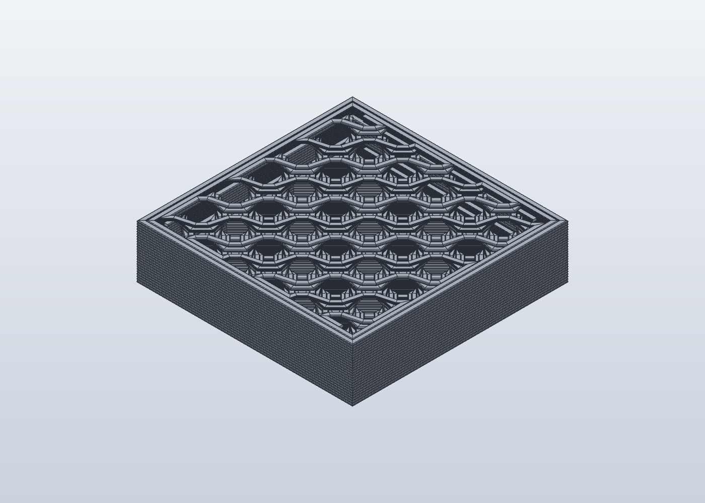
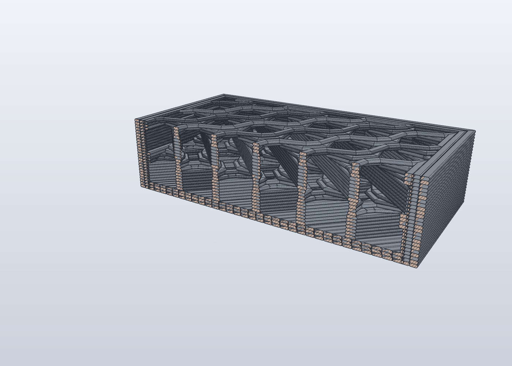
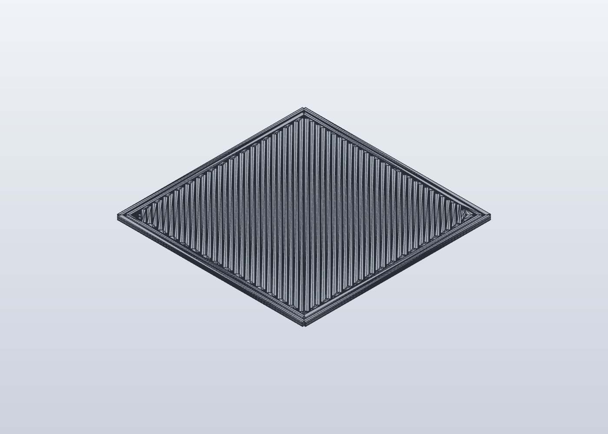

# GCode-FEA

**Turn a sliced 3D print into simulation-ready geometry — at the level of the individual plastic strands, not a smooth idealised surface.**

[](https://github.com/nicholasgower/gcode-fea/actions/workflows/nightly.yml)

GCode-FEA is an add-on for [OrcaSlicer](https://www.orcaslicer.com/) (a popular 3D-printing slicer) plus a standalone Python library. It reads what the slicer is about to print and exports the print's actual internal structure for finite element analysis (FEA) — the kind of computer simulation engineers use to predict where a part will crack, bend, or delaminate.

> **AI disclosure:** This project was fully generated by **DeepSeek V4.1 Flash**, an AI coding model, under human direction. It has not been independently audited. Review the code and results before relying on them for safety-critical or production work. See [AI disclosure](#ai-disclosure) below.

## The simple version

A 3D printer does not create a solid block of plastic. It squeezes out a thin rope of melted plastic — a **bead** — and lays it down line by line, layer by layer. The part is really thousands of these beads pressed together, with tiny gaps and weak joints between them.

Most CAD and simulation tools treat the printed part as a smooth solid. That hides the very features that cause real printed parts to fail: the bonds between beads, the gaps between layers, and the direction each strand runs.

GCode-FEA takes the slicer's own instructions and rebuilds that bead-by-bead structure as a CAD model. You can then import it into simulation software and study questions like:

- Will this part split between layers before the plastic itself breaks?
- How much weaker is a print in one direction than another?
- Where do the voids and poor bonds sit inside the part?

## What you get

An export can produce:

| Output | What it is |
|---|---|
| `beads.step` / `beads.stp` | A CAD file of the as-printed geometry, one body per bead or one merged body |
| `beads.json` | A data file describing every bead, contact, interface, and process setting |
| `report.json` | A plain summary of volume, voids, contacts, warnings, and timing |
| `beads.stl` | An optional surface mesh for viewing |
| Volume mesh | An optional analysis-ready mesh for a solver |

The JSON sidecar is the important part for research: the STEP file is just shape, while the sidecar carries the measurements and assumptions behind it.

## What it looks like

These screenshots are actual STEP files exported by GCode-FEA and opened in SolidCraft, an independent CAD viewer.

**Planar export: every bead remains its own body**



This is the first 25 layers of the 20 mm cube test fixture (about 5 mm tall). The top surface shows the printed bead paths. The planar engine preserves bead identity, so you can still see each strand and the gaps between them.

**Section through the same export: layers, bead cross-sections, and voids**



A vertical cut reveals how the beads stack layer by layer, where they touch, and where the voids are. The tan hatched faces are the cut cross-sections.

**Merged export: overlapping beads become one body**



The merged engine boolean-unions overlapping beads into a single closed body. This is the default for viewing, because it avoids interpenetrating solids and imports more cleanly. This view is the first two layers of the same cube.

## Who this is for

- **Researchers** studying fracture and layer adhesion in fused-filament fabrication (FFF) prints.
- **Engineers** who need as-printed geometry rather than nominal CAD for simulation.
- **Slicer developers** who want to inspect what a slice really contains.
- **Curious makers** who want to see the internal structure of a print.

You do not need to be a programmer to use the plugin, but the current beta is aimed at technically comfortable users. The command-line library is for automation and research.

## Quick start (OrcaSlicer plugin)

**Requirements**

- OrcaSlicer **2.5.0-beta, build `345efec6`** (the plugin API is experimental and version-specific)
- Linux is the currently verified platform (Linux Mint 22 / Ubuntu 24.04)
- Python 3.12 or newer for the build step

**1. Build the plugin wheel**

```bash
python3 helper_scripts/build_plugin_wheel.py --out dist
```

This creates `dist/gcode_fea_orca-0.1.0-py3-none-any.whl`, which bundles the plugin and the core library.

**2. Install it**

```bash
mkdir -p ~/.config/OrcaSlicer/orca_plugins/gcode_fea
cp dist/gcode_fea_orca-0.1.0-py3-none-any.whl \
   ~/.config/OrcaSlicer/orca_plugins/gcode_fea/
```

Restart OrcaSlicer and enable the plugin and its three capabilities in **File → Plugins**:

- **Capture Slice Cache**
- **Export FEA Geometry**
- **Export STEP (viewable)**

**3. Slice and export**

1. Open a model and slice it normally.
2. The capture capability records the bead structure during slicing.
3. Run **Export FEA Geometry** from the Plugins window or the Space-bar search.
4. Your files appear in OrcaSlicer's plugin data folder, or in a folder you choose.

The full walkthrough, configuration options, and troubleshooting are in [docs/plugin_user_guide.md](docs/plugin_user_guide.md).

## Quick start (command line)

For scripted use, install the project and run the CLI against a saved slice probe or cache:

```bash
uv sync
uv run python -m gcode_fea.cli \
  --probe tests/fixtures/phase1/cube20_probe.json \
  --out out/phase1-cube20 \
  --resolution 0.2
```

Expected outputs:

```text
out/phase1-cube20/beads.json
out/phase1-cube20/report.json
```

Add a STEP file with:

```bash
uv run --with manifold3d python -m gcode_fea.cli \
  --probe tests/fixtures/phase0/phase0_probe_obj102.json \
  --out out/phase0-step \
  --step out/phase0-step/beads.step \
  --step-engine merged \
  --step-tolerance 0.005
```

The merged STEP engine needs the optional `manifold3d` package; the pure-Python `planar` engine needs nothing extra. Full parts can produce very large files, so use `--layer-range` or `--roi` for a smaller export.

## Useful helpers

The repository includes small read-only tools for checking exports:

```bash
# Is every solid in this STEP file a closed shell? Optionally require one body.
python3 helper_scripts/step_audit.py out/phase1-step/beads.step --expect-one-body

# Estimate STEP size and a practical layer range before writing.
python3 helper_scripts/step_budget.py \
  --probe tests/fixtures/phase0/phase0_probe_obj102.json \
  --engine planar --tolerance 0.005

# Check that the plugin stages writes safely and declares its process commands.
python3 helper_scripts/plugin_permission_audit.py
```

## Releasing a new plugin version

Maintainers publish plugin builds to GitHub Releases:

1. Bump `version` in both `pyproject.toml` and the plugin PEP 723 metadata.
2. Add a matching `## <version> - YYYY-MM-DD` section to `CHANGELOG.md`.
3. Commit and push the changes.
4. Run the release helper:

```bash
# Validate the version, changelog, repository state, and release plan.
python3 helper_scripts/release_plugin.py --dry-run

# Run tests, build the wheel, create the tag/release, and upload the wheel.
python3 helper_scripts/release_plugin.py
```

The script requires a clean working tree and an authenticated `gh` CLI. It uses
the matching changelog section as the GitHub release notes and uploads
`gcode_fea_orca-<version>-py3-none-any.whl`. Use `--draft`, `--prerelease`,
`--skip-tests`, `--notes-file`, `--tag`, or `--repo` when needed.

Every push to `main` also runs the **Nightly plugin build** workflow. If all
unit tests pass, it moves the `nightly` tag and updates the rolling **GCode-FEA
nightly** prerelease with a fresh wheel and the latest commit message. Nightly
builds are unsigned and may be unstable; use a versioned release for production.

## Current status

The core geometry pipeline and the plugin workflow are implemented and tested:

- bead cross-sections and volume-conserving sweeps,
- contact and interface detection,
- sidecar, report, STL, and STEP export,
- cohesive-interface and process-informed adhesion tooling,
- the OrcaSlicer capture/export plugin.

Important limits, stated plainly:

- **No solver validation has been run yet.** The benchmark and cohesive jobs produce solver input files, but no finite element solver has been run and recorded here.
- **No physical print validation has been run yet.** Coupon mass, dimensions, and bond strength have not been measured on the reference printer.
- **The plugin API is experimental.** It is pinned to OrcaSlicer 2.5.0-beta build `345efec6`; other builds may behave differently.
- **Large parts need a region of interest.** A whole-part bead-resolved model is not the default because files and meshing costs grow quickly.

The phased plan and open decisions are tracked in [ROADMAP.md](ROADMAP.md).

## Project layout

```text
src/gcode_fea/        core library (geometry, contacts, export, solvers)
plugins/gcode_fea/    OrcaSlicer adapter
plugins/phase0_probe/  early slicing-pipeline probe
helper_scripts/       environment, slicing, packaging, and audit helpers
tests/                unit, integration, and regression tests
docs/                 reports and user guides
sources/              reference paper (CC BY 4.0)
```

The core does **not** depend on OrcaSlicer. The adapter is deliberately thin: it captures the live slice, then hands the data to the core.

## Documentation

- [Plugin user guide](docs/plugin_user_guide.md) — install, configure, export, troubleshoot
- [Phase 1 core report](docs/phase1_report.md) — geometry approach and limitations
- [Paper benchmark](docs/paper_benchmark.md) — coupon and solver tooling
- [Cohesive interfaces](docs/cohesive_interfaces.md) — interface extraction and cohesive decks
- [Process-informed adhesion](docs/process_adhesion.md) — G-code process data and bond quality
- [OrcaSlicer issue reports](docs/orcaslicer_issue_reports.md) — upstream beta issues found during development
- [Changelog](CHANGELOG.md) — release history
- [Development rules](AGENTS.md) — modeling assumptions and engineering conventions
- [Roadmap](ROADMAP.md) — phases, decisions, and risks

## AI disclosure

This repository — including its source code, tests, helper scripts, and documentation — was **fully generated by DeepSeek V4.1 Flash**, an AI coding model, under human direction.

What that means in practice:

- The design and requirements were set through human prompts and review.
- The tests and checks reported in the documentation were run in the development environment.
- No independent human line-by-line audit has been performed.
- Treat the output as a capable starting point, not as certified engineering software.

If you use this project for research or production, validate it against your own prints, solver, and requirements.

## License and credits

- Original project code: **MIT** — see [LICENSE](LICENSE).
- The reference paper is **CC BY 4.0**; attribution and changes are recorded in [CREDITS.md](CREDITS.md).
- OrcaSlicer is **AGPL-3.0**; this project's MIT core does not copy OrcaSlicer source code.
- Third-party tools such as NumPy, Shapely, Manifold3D, and gmsh keep their own licenses.
